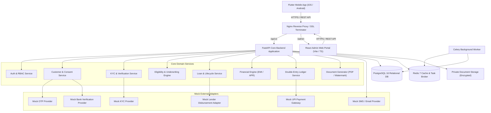

# LOANORBIT — System Architecture & Component Design

**Platform:** LOANORBIT  
**Architecture Style:** Modular Clean Architecture / Domain-Driven Micro-Modular Monolith  
**Version:** 1.0.0-sandbox  

---

## 1. High-Level Architecture Diagram

---

## 2. Component Breakdown

### 2.1 Customer Mobile Application (Flutter)
- **Framework:** Flutter 3.x (Dart 3.x).
- **State Management:** Riverpod 2.x for reactive, compile-safe dependency injection and state tracking.
- **Routing:** GoRouter with declarative route guards (auth status, onboarding progression, KYC gates).
- **HTTP Client:** Dio with custom interceptors for Bearer token injection, automatic refresh token retry, correlation ID tagging, and offline error wrapping.
- **Local Storage:** `flutter_secure_storage` for storing JWT access and refresh tokens.
- **Theme & Design System:** LOANORBIT custom fintech theme inspired by high-speed digital credit journeys with orbital financial accents (deep emerald primary, vibrant electric teal accent, slate neutrals).

### 2.2 Admin Web Application (React)
- **Framework:** React 18+ bootstrapped with Vite.
- **Language:** TypeScript in strict mode.
- **Styling:** Tailwind CSS with headless component patterns.
- **Data Fetching:** TanStack Query (React Query) for server-state caching, invalidation, and optimistic updates.
- **Form Management:** React Hook Form coupled with Zod validation schemas.
- **Layout:** Responsive desktop-first dashboard with collapsible sidebar, KPI metric cards, interactive data tables with server-side pagination/filtering, document preview modals, and underwriting workspaces.

### 2.3 Backend API (FastAPI)
- **Framework:** FastAPI with Python 3.11.
- **ORM / Persistence:** SQLAlchemy 2.0 (asyncio-ready) with declarative mapping.
- **Schema Validation:** Pydantic v2 for request/response serialization and strict type guarantees.
- **Database Migrations:** Alembic with version-controlled, reversible migration scripts.
- **Security:** Passlib with Argon2id hashing, python-jose for JWT signing/verification.
- **Background Tasks:** Redis + Celery / FastAPI background tasks for async PDF generation, mock provider callbacks, and audit logging.

### 2.4 Data Tier
- **Primary Database:** PostgreSQL 16.
- **Caching & Locks:** Redis 7 for distributed rate-limiting, idempotency keys, and temporary tokens.
- **Document Storage:** Sandboxed private filesystem storage outside public HTTP root with file magic number validation and expiring signed token access.

---

## 3. Communication Protocols & Security Layers

1. **REST APIs:** All client-server communication occurs over standard HTTPS via `/api/v1/*`.
2. **Correlation ID:** Every HTTP request carries an `X-Correlation-ID` header, propagated through logs, service calls, and error payloads.
3. **Idempotency:** Sensitive mutations (`POST /disbursements`, `POST /payments`, `POST /applications`) accept an `Idempotency-Key` header stored in Postgres/Redis to prevent duplicate financial events.
4. **Data Isolation:** Row-level customer tenancy is strictly enforced at the repository and service layer — a customer token cannot access any resource belonging to another customer ID.
