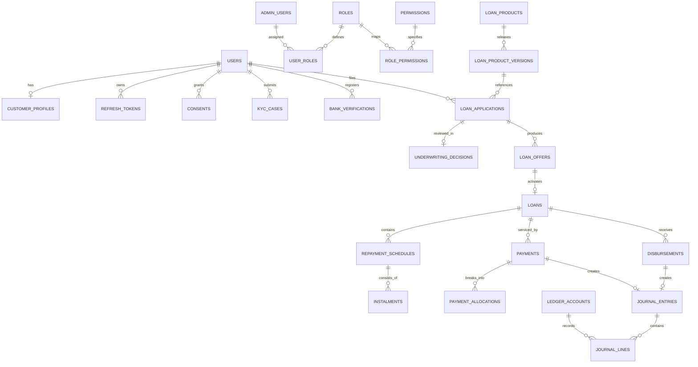

# LOANORBIT — Relational Database Design Specification

**Database Engine:** PostgreSQL 16  
**Primary Key Convention:** UUIDv4  
**Currency Convention:** Integer Paise (e.g., ₹10,000.00 = 1,000,000 paise)  
**Time Convention:** Timestamps with Timezone (UTC)  

---

## 1. Entity-Relationship Model Overview

The database design is strictly normalized to 3NF/BCNF with explicit foreign keys, non-nullable constraints, check constraints, and performance indexes.

---

## 2. Table Schemas & Definitions

### 2.1 Identity, RBAC & Customer Domain

#### `users`
- `id` (UUID, PK)
- `mobile_number` (VARCHAR(15), UNIQUE, NOT NULL)
- `email` (VARCHAR(255), UNIQUE, NULL)
- `hashed_password` (VARCHAR(255), NULL) -- For customer password if set
- `is_active` (BOOLEAN, DEFAULT TRUE)
- `is_verified` (BOOLEAN, DEFAULT FALSE)
- `created_at` (TIMESTAMPTZ, DEFAULT NOW())
- `updated_at` (TIMESTAMPTZ, DEFAULT NOW())

#### `customer_profiles`
- `id` (UUID, PK)
- `user_id` (UUID, FK -> users.id, UNIQUE, NOT NULL)
- `full_name` (VARCHAR(255), NOT NULL)
- `date_of_birth` (DATE, NOT NULL)
- `gender` (VARCHAR(20), NOT NULL)
- `address_line1` (VARCHAR(255), NOT NULL)
- `address_line2` (VARCHAR(255), NULL)
- `city` (VARCHAR(100), NOT NULL)
- `state` (VARCHAR(100), NOT NULL)
- `pincode` (VARCHAR(10), NOT NULL)
- `employment_type` (VARCHAR(50), NOT NULL) -- SALARIED, SELF_EMPLOYED, STUDENT
- `monthly_income_paise` (BIGINT, NOT NULL)
- `monthly_expenses_paise` (BIGINT, NOT NULL)
- `employer_name` (VARCHAR(255), NULL)
- `employment_duration_months` (INT, NULL)
- `created_at` (TIMESTAMPTZ, DEFAULT NOW())
- `updated_at` (TIMESTAMPTZ, DEFAULT NOW())

#### `admin_users`
- `id` (UUID, PK)
- `username` (VARCHAR(100), UNIQUE, NOT NULL)
- `email` (VARCHAR(255), UNIQUE, NOT NULL)
- `full_name` (VARCHAR(255), NOT NULL)
- `hashed_password` (VARCHAR(255), NOT NULL)
- `is_active` (BOOLEAN, DEFAULT TRUE)
- `created_at` (TIMESTAMPTZ, DEFAULT NOW())

#### `roles` & `permissions` & `role_permissions` & `user_roles`
Standard enterprise RBAC linking admin users to roles and specific permissions (`KYC_VERIFY`, `UNDERWRITE_APPROVE`, `LEDGER_POST`, etc.).

---

### 2.2 Consents & Verifications

#### `consents`
- `id` (UUID, PK)
- `user_id` (UUID, FK -> users.id, NOT NULL)
- `purpose` (VARCHAR(100), NOT NULL) -- PRIVACY_POLICY, TERMS, KYC_FETCH, LENDER_SHARING
- `policy_version` (VARCHAR(20), NOT NULL)
- `status` (VARCHAR(20), NOT NULL) -- ACCEPTED, REJECTED, REVOKED
- `ip_address` (VARCHAR(45), NULL)
- `user_agent` (VARCHAR(255), NULL)
- `timestamp` (TIMESTAMPTZ, DEFAULT NOW())

#### `kyc_cases` & `kyc_documents` & `kyc_decisions`
- `kyc_cases`: `id`, `user_id`, `id_type` (PAN, AADHAAR_CARD, PASSPORT), `id_number_masked`, `status` (`PENDING`, `VERIFIED`, `REJECTED`, `RESUBMISSION_REQUESTED`).
- `kyc_documents`: `id`, `kyc_case_id`, `doc_type`, `file_path`, `file_hash`, `file_size_bytes`, `mime_type`.
- `kyc_decisions`: `id`, `kyc_case_id`, `officer_id`, `decision`, `reason_code`, `remarks`, `created_at`.

#### `bank_verifications`
- `id` (UUID, PK)
- `user_id` (UUID, FK -> users.id, NOT NULL)
- `account_holder_name` (VARCHAR(255), NOT NULL)
- `bank_name` (VARCHAR(100), NOT NULL)
- `account_number_masked` (VARCHAR(50), NOT NULL)
- `ifsc_code` (VARCHAR(20), NOT NULL)
- `status` (VARCHAR(30), NOT NULL) -- `VERIFIED`, `NAME_MISMATCH`, `INVALID_ACCOUNT`, `FAILED`
- `penny_drop_reference` (VARCHAR(100), NULL)
- `verified_at` (TIMESTAMPTZ, NULL)

---

### 2.3 Loan Catalog & Application Domain

#### `loan_products` & `loan_product_versions`
- `loan_products`: `id`, `code`, `name`, `description`, `is_active`, `current_version_id`.
- `loan_product_versions`: `id`, `product_id`, `version_number`, `min_principal_paise`, `max_principal_paise`, `available_tenures_months` (INT[]), `annual_nominal_interest_rate_bps` (INT, e.g. 1800 = 18.00%), `processing_fee_type` (`FIXED` or `PERCENTAGE`), `processing_fee_value` (Paise or Bps), `gst_rate_bps` (e.g. 1800 = 18%), `late_charge_daily_bps` (e.g. 5 = 0.05%/day), `created_at`.

#### `loan_applications`
- `id` (UUID, PK)
- `application_reference` (VARCHAR(50), UNIQUE, NOT NULL)
- `user_id` (UUID, FK -> users.id, NOT NULL)
- `product_version_id` (UUID, FK -> loan_product_versions.id, NOT NULL)
- `requested_amount_paise` (BIGINT, NOT NULL)
- `requested_tenure_months` (INT, NOT NULL)
- `purpose` (VARCHAR(255), NOT NULL)
- `status` (VARCHAR(50), NOT NULL) -- `SUBMITTED`, `UNDER_REVIEW`, `INFO_REQUESTED`, `APPROVED`, `REJECTED`, `OFFER_ACCEPTED`, `DISBURSED`, `EXPIRED`, `CANCELLED`
- `created_at` (TIMESTAMPTZ, DEFAULT NOW())
- `updated_at` (TIMESTAMPTZ, DEFAULT NOW())

#### `underwriting_decisions`
- `id` (UUID, PK)
- `application_id` (UUID, FK -> loan_applications.id, NOT NULL)
- `underwriter_id` (UUID, FK -> admin_users.id, NOT NULL)
- `decision` (VARCHAR(30), NOT NULL) -- `APPROVED`, `REJECTED`, `ADDITIONAL_INFO_REQUIRED`
- `approved_amount_paise` (BIGINT, NULL)
- `approved_tenure_months` (INT, NULL)
- `approved_rate_bps` (INT, NULL)
- `rule_engine_score` (INT, NULL)
- `remarks` (TEXT, NOT NULL)
- `policy_version` (VARCHAR(50), NOT NULL)
- `created_at` (TIMESTAMPTZ, DEFAULT NOW())

#### `loan_offers`
- `id` (UUID, PK)
- `application_id` (UUID, FK -> loan_applications.id, NOT NULL)
- `offer_reference` (VARCHAR(50), UNIQUE, NOT NULL)
- `offered_amount_paise` (BIGINT, NOT NULL)
- `tenure_months` (INT, NOT NULL)
- `annual_nominal_interest_rate_bps` (INT, NOT NULL)
- `monthly_emi_paise` (BIGINT, NOT NULL)
- `processing_fee_paise` (BIGINT, NOT NULL)
- `gst_paise` (BIGINT, NOT NULL)
- `net_disbursement_paise` (BIGINT, NOT NULL)
- `total_repayable_paise` (BIGINT, NOT NULL)
- `apr_bps` (INT, NOT NULL)
- `status` (VARCHAR(30), NOT NULL) -- `ISSUED`, `ACCEPTED`, `REJECTED`, `EXPIRED`
- `expires_at` (TIMESTAMPTZ, NOT NULL)
- `created_at` (TIMESTAMPTZ, DEFAULT NOW())

---

### 2.4 Loans, Instalments, Disbursements & Repayments

#### `loans`
- `id` (UUID, PK)
- `loan_reference` (VARCHAR(50), UNIQUE, NOT NULL)
- `user_id` (UUID, FK -> users.id, NOT NULL)
- `application_id` (UUID, FK -> loan_applications.id, NOT NULL)
- `offer_id` (UUID, FK -> loan_offers.id, NOT NULL)
- `principal_paise` (BIGINT, NOT NULL)
- `outstanding_principal_paise` (BIGINT, NOT NULL)
- `outstanding_interest_paise` (BIGINT, NOT NULL)
- `outstanding_penalties_paise` (BIGINT, DEFAULT 0)
- `status` (VARCHAR(30), NOT NULL) -- `PENDING_DISBURSEMENT`, `ACTIVE`, `OVERDUE`, `FORECLOSED`, `CLOSED`
- `disbursed_at` (TIMESTAMPTZ, NULL)
- `closed_at` (TIMESTAMPTZ, NULL)
- `created_at` (TIMESTAMPTZ, DEFAULT NOW())

#### `instalments`
- `id` (UUID, PK)
- `loan_id` (UUID, FK -> loans.id, NOT NULL)
- `instalment_number` (INT, NOT NULL)
- `due_date` (DATE, NOT NULL)
- `opening_principal_paise` (BIGINT, NOT NULL)
- `emi_amount_paise` (BIGINT, NOT NULL)
- `principal_component_paise` (BIGINT, NOT NULL)
- `interest_component_paise` (BIGINT, NOT NULL)
- `closing_principal_paise` (BIGINT, NOT NULL)
- `paid_principal_paise` (BIGINT, DEFAULT 0)
- `paid_interest_paise` (BIGINT, DEFAULT 0)
- `outstanding_amount_paise` (BIGINT, NOT NULL)
- `status` (VARCHAR(20), NOT NULL) -- `SCHEDULED`, `PARTIALLY_PAID`, `PAID`, `OVERDUE`

#### `disbursements`
- `id` (UUID, PK)
- `loan_id` (UUID, FK -> loans.id, NOT NULL)
- `amount_paise` (BIGINT, NOT NULL)
- `bank_verification_id` (UUID, FK -> bank_verifications.id, NOT NULL)
- `mock_provider_reference` (VARCHAR(100), NULL)
- `status` (VARCHAR(30), NOT NULL) -- `INITIATED`, `SUCCESS`, `FAILED`
- `failure_reason` (TEXT, NULL)
- `disbursed_at` (TIMESTAMPTZ, NULL)

#### `payments` & `payment_allocations`
- `payments`: `id`, `loan_id`, `amount_paise`, `payment_method` (`UPI_MOCK`), `status` (`SUCCESS`, `FAILED`, `PENDING`, `REVERSED`), `provider_reference`, `paid_at`.
- `payment_allocations`: `id`, `payment_id`, `instalment_id`, `allocated_principal_paise`, `allocated_interest_paise`, `allocated_charges_paise`, `created_at`.

---

### 2.5 Double-Entry Ledger System

#### `ledger_accounts`
- `id` (UUID, PK)
- `account_code` (VARCHAR(50), UNIQUE, NOT NULL)
- `account_name` (VARCHAR(100), NOT NULL)
- `account_type` (VARCHAR(30), NOT NULL) -- `ASSET`, `LIABILITY`, `EQUITY`, `REVENUE`, `EXPENSE`
- `balance_paise` (BIGINT, DEFAULT 0)

*Standard Chart of Accounts:*
- `1001`: Cash / Settlement Pool (Asset)
- `1101`: Loan Principal Receivable (Asset)
- `1102`: Interest Receivable (Asset)
- `1103`: Penalties Receivable (Asset)
- `2001`: Borrower Overpayment Holding (Liability)
- `3001`: Capital / Equity (Equity)
- `4001`: Interest Income (Revenue)
- `4002`: Processing Fee Income (Revenue)
- `2101`: GST Payable on Fees (Liability)

#### `journal_entries` & `journal_lines`
- `journal_entries`: `id`, `entry_reference`, `entry_type` (`DISBURSEMENT`, `REPAYMENT`, `FEE_ACCRUAL`, `REVERSAL`), `description`, `posted_at`.
- `journal_lines`: `id`, `journal_entry_id`, `account_id`, `entry_direction` (`DEBIT` or `CREDIT`), `amount_paise`, `created_at`.
- **Constraint:** $\sum \text{DEBITS} = \sum \text{CREDITS}$ per `journal_entry_id`.
